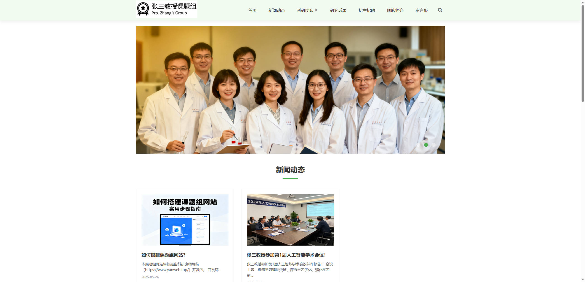
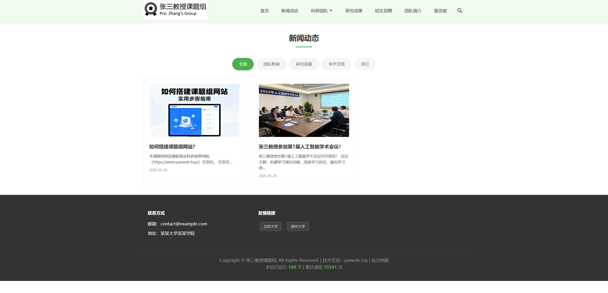
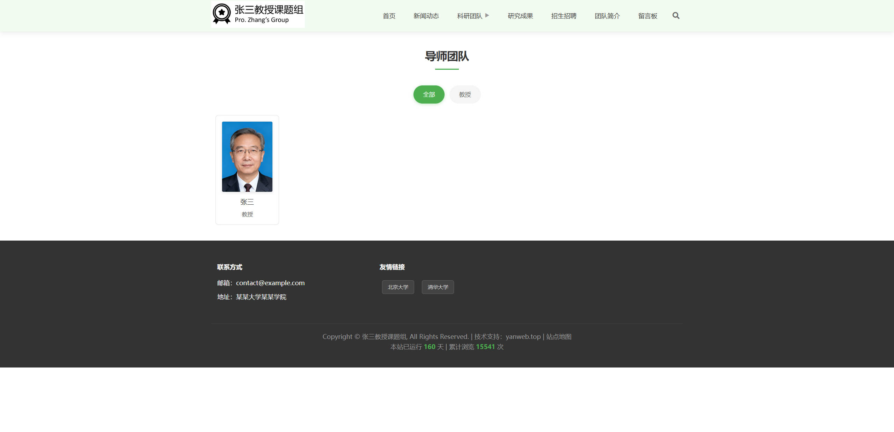
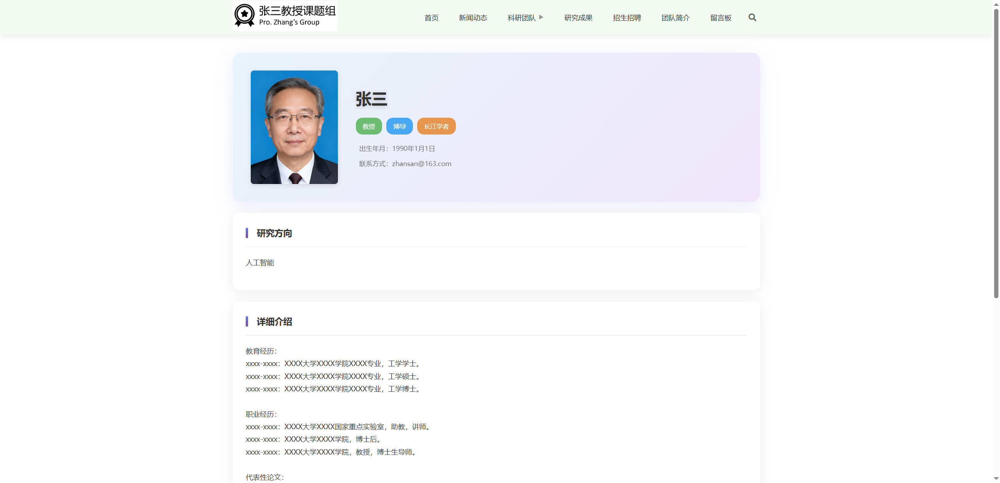
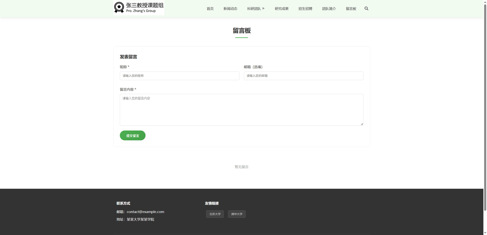
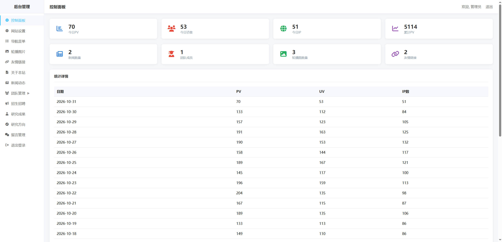

# 课题组官网模板


面向高校科研课题组 / 实验室的轻量级官网系统。原生 PHP 编写，不依赖框架与 Composer，内置安装向导、可视化后台、Markdown 编辑器、图片上传、留言审核、访问统计与站点地图生成，开箱即可搭建一个结构完整、移动端适配的课题组网站。

## 界面预览

> 以下为截图占位路径。将截图按对应文件名放入 `docs/screenshots/` 即可自动显示，建议宽度 1440px。

<table>
  <tr>
    <td width="50%" align="center"><br><b>首页</b>：轮播图与内容区块</td>
    <td width="50%" align="center"><br><b>新闻动态</b>：分类筛选与分页</td>
  </tr>
  <tr>
    <td width="50%" align="center"><br><b>导师团队</b>：成员列表与职称筛选</td>
    <td width="50%" align="center"><br><b>导师详情</b>：个人信息与研究介绍</td>
  </tr>
  <tr>
    <td width="50%" align="center"><br><b>留言板</b>：留言、评论与分页</td>
    <td width="50%" align="center"><br><b>后台控制面板</b>：访问统计与内容概览</td>
  </tr>
</table>

## 功能特性

### 前台

- **首页**：全屏轮播图（自动切换 + 手动切换）、新闻动态、研究成果、导师团队、研究方向五个内容区块
- **新闻动态**：分类筛选、分页浏览、详情页 Markdown 渲染
- **科研团队**：导师、博士后、博士、硕士、毕业生五类成员，支持列表、详情、导师按职称筛选
- **研究方向**：图文卡片展示与详情页
- **研究成果**：成果列表与详情页
- **招生招聘**：招生 / 招聘分类展示与详情页
- **关于我们**：支持 Markdown 排版的团队介绍页
- **留言板**：访客留言、楼中楼评论、后台审核后展示、分页
- **全站搜索**：覆盖新闻、研究成果、招生招聘、导师信息，关键词高亮与摘要截取
- **站点信息**：友情链接、联系方式、ICP / 公安备案、运行天数、累计浏览量
- **响应式导航**：移动端汉堡菜单、下拉子菜单、折叠搜索框

### 后台（`/admin/`）

- **控制面板**：今日 PV / UV / IP、累计 PV、近 30 天访问明细、内容数量统计、待审核留言提醒
- **网站设置**：站点名称、图标、Logo、关键词、描述、版权、ICP 备案、公安备案、邮箱、地址、站点 URL，以及管理员用户名 / 密码修改
- **导航菜单**：父子两级菜单、排序、启用状态、当前窗口 / 新窗口打开
- **轮播图片**：上传、排序、启用状态、删除（同时清理图片文件）
- **友情链接**：新增、编辑、排序、启用状态
- **关于本站**：Markdown 编辑器在线编辑
- **新闻动态**：新闻增删改查、封面图上传、分类管理（有内容时禁止删除分类）
- **团队管理**：导师、博士后、博士、硕士、毕业生五类成员增删改查，照片上传、排序、富文本介绍
- **招生招聘**：招生 / 招聘信息管理
- **研究成果**：成果增删改查、封面图上传
- **研究方向**：方向增删改查、封面图上传、排序
- **留言管理**：留言与评论审核 / 删除、状态筛选、分页

### 系统

- 图形化安装向导，自动建表、写入配置、生成演示数据与 `install.lock`
- Markdown 编辑器（editormd + CodeMirror），支持图片上传、表格、代码块、Emoji、全屏、实时预览
- 图片按 `年/月` 目录归档，上传后自动重命名
- 全站 SEO：页面级标题、keywords / description、`robots.txt`、动态 `sitemap.xml`
- 数据库统一 `utf8mb4`，支持中文与 Emoji

## 技术栈

| 类别 | 说明 |
| --- | --- |
| 服务端 | PHP 7.2+（原生，无框架、无 Composer 依赖） |
| 数据库 | MySQL 5.7+，`mysqli` 预处理语句，字符集 `utf8mb4` |
| 编辑器 | editormd + CodeMirror + marked + prettify（已内置在 `editor/`） |
| 前端 | 原生 HTML / CSS / JavaScript，响应式布局 |
| 图标 | Font Awesome 5 / 6（CDN） |
| 模板 | 原生 PHP 模板包含（`templates/header.html`、`templates/footer.html`） |

## 环境要求

- PHP >= 7.2，需启用 `mysqli`（建议使用 mysqlnd 驱动，代码依赖 `mysqli_result::fetch_assoc` / `get_result`）
- MySQL >= 5.7
- Nginx 或 Apache
- 可写目录：`include/`（安装时写入配置）、`upload/`
- 推荐开启 HTTPS

已在 Nginx 1.15.10 + MySQL 5.7.23 + PHP 7.2 环境下运行验证。

## 快速开始

### 1. 准备数据库

在 MySQL 中创建空数据库（字符集建议 `utf8mb4`）：

```sql
CREATE DATABASE `group_io` DEFAULT CHARACTER SET utf8mb4 COLLATE utf8mb4_general_ci;
```

### 2. 上传程序

将项目文件上传至 Web 根目录（如 `/www/wwwroot/group.io/`），并确保 `include/` 与 `upload/` 可写。

### 3. 运行安装向导

浏览器访问：

```text
https://your-domain.com/install.php
```

填写数据库主机、用户名、密码、数据库名，提交后安装程序将：

1. 创建全部数据表（表前缀固定为 `group_`）
2. 写入默认站点配置、导航菜单、新闻分类、友情链接、轮播图与示例数据
3. 生成 `include/config.php`
4. 生成 `install.lock` 安装锁文件

安装完成后：

- 前台首页：`/`
- 后台入口：`/admin/login.php`
- 初始账号：`admin`
- 初始密码：`admin`

> 首次登录后请立即在「网站设置 → 账户设置」中修改用户名与密码。

### 4. 服务器配置

**Nginx**（站点地图重写，使 `/sitemap.xml` 输出动态内容）：

```nginx
index index.php index.html;

location = /sitemap.xml {
    rewrite ^/sitemap.xml$ /sitemap.php last;
}
```

**Apache**（`.htaccess` 当前为空，可按需补充）：

```apache
DirectoryIndex index.php index.html
RewriteEngine On
RewriteRule ^sitemap\.xml$ sitemap.php [L]
```

同时建议限制 `upload/` 目录执行 PHP：

```nginx
location ^~ /upload/ {
    location ~ \.php$ { return 403; }
}
```

### 5. 安装后检查

- 确认 `install.lock` 存在，避免误访问 `install.php` 重复安装（重复执行会 **DROP 并重建数据表**）
- 确认上传图片可正常显示
- 访问 `/sitemap.php` 或 `/sitemap.xml` 检查站点地图输出

## 目录结构

```text
group.io/
├── index.php                  # 首页（轮播、新闻、成果、导师、研究方向）
├── install.php                # 安装向导（建表、写配置、生成 install.lock）
├── sitemap.php                # 动态输出 sitemap.xml
├── robots.txt                 # 搜索引擎抓取规则
├── nginx.htaccess             # Nginx 站点地图重写规则示例
├── include/
│   ├── config.php             # 数据库与站点常量（安装时生成）
│   ├── db.class.php           # mysqli 单例封装（查询 / 增删改）
│   ├── common.php             # 公共函数：站点配置、菜单、上传、统计、SEO
│   └── markdown.php           # 轻量 Markdown 解析器（标题/表格/图片/图标等）
├── templates/
│   ├── header.html            # 公共头部：SEO、导航、搜索
│   └── footer.html            # 公共底部：联系方式、友链、备案、统计
├── admin/                     # 后台管理（19 个页面）
│   ├── login.php / logout.php
│   ├── index.php              # 控制面板与访问统计
│   ├── config.php             # 网站设置与账户设置
│   ├── menu.php               # 导航菜单
│   ├── slide.php              # 轮播图
│   ├── friend_link.php        # 友情链接
│   ├── about.php              # 关于本站
│   ├── news.php               # 新闻动态
│   ├── news_category.php      # 新闻分类
│   ├── teacher.php / postdoc.php / master.php / doctor.php / graduate.php
│   ├── recruit.php            # 招生招聘
│   ├── research.php           # 研究成果
│   ├── research_direction.php # 研究方向
│   └── message.php            # 留言审核
├── about/                     # 关于我们
├── news/                      # 新闻列表 / 详情
├── teacher/                   # 导师团队列表 / 详情
├── postdoc/                   # 博士后团队列表 / 详情
├── doctor/                    # 博士团队列表 / 详情
├── master/                    # 硕士团队列表 / 详情
├── graduate/                  # 毕业生团队列表 / 详情
├── research/                  # 研究成果列表 / 详情
├── research_direction/        # 研究方向详情
├── recruit/                   # 招生招聘列表 / 详情
├── message/                   # 留言板
├── search/                    # 全站搜索
├── editor/                    # editormd + CodeMirror 前端资源
├── static/
│   ├── css/style.css          # 前台样式
│   ├── css/admin.css          # 后台样式
│   ├── js/main.js             # 轮播、移动端菜单、搜索框
│   └── images/                # Logo、默认背景图
└── upload/                    # 上传图片（按 年/月 归档）
```

## 页面路由

| 路径 | 说明 |
| --- | --- |
| `/` | 首页 |
| `/about/` | 关于我们 |
| `/news/`、`/news/detail.php?id=1` | 新闻列表、新闻详情 |
| `/teacher/`、`/teacher/?title=1` | 导师团队、按职称筛选 |
| `/teacher/detail.php?id=1` | 导师详情 |
| `/postdoc/`、`/postdoc/detail.php?id=1` | 博士后团队、详情 |
| `/doctor/`、`/doctor/detail.php?id=1` | 博士团队、详情 |
| `/master/`、`/master/detail.php?id=1` | 硕士团队、详情 |
| `/graduate/`、`/graduate/detail.php?id=1` | 毕业生团队、详情 |
| `/research/`、`/research/detail.php?id=1` | 研究成果、详情 |
| `/research_direction/detail.php?id=1` | 研究方向详情 |
| `/recruit/`、`/recruit/detail.php?id=1` | 招生招聘、详情 |
| `/message/` | 留言板（留言 + 评论） |
| `/search/?q=关键词` | 全站搜索 |
| `/sitemap.xml` | 站点地图（需服务器重写至 `sitemap.php`） |
| `/admin/login.php` | 后台登录 |
| `/install.php` | 安装向导（安装后请保留 `install.lock`） |

## 数据库结构

所有表使用 `group_` 前缀，`utf8mb4` 编码，UTF-8 排序规则。

| 表名 | 用途 | 关键字段 |
| --- | --- | --- |
| `group_config` | 站点配置与管理员账号 | `title`、`icon`、`logo`、`keywords`、`description`、`copyright`、`icp`、`police`、`email`、`address`、`site_url`、`admin_user`、`admin_pass` |
| `group_slide` | 首页轮播图 | `image`、`sort_order`、`status` |
| `group_menu` | 导航菜单 | `name`、`url`、`target`、`parent_id`、`sort_order`、`status` |
| `group_friend_link` | 友情链接 | `name`、`url`、`sort_order`、`status` |
| `group_about` | 关于本站内容 | `content`、`update_time` |
| `group_news_category` | 新闻分类 | `name`、`sort_order` |
| `group_news` | 新闻动态 | `title`、`category_id`、`content`、`image`、`create_time`、`update_time` |
| `group_teacher` | 导师团队 | `name`、`gender`、`birth_date`、`title`、`position`、`honor`、`email`、`research`、`photo`、`content`、`sort_order` |
| `group_postdoc` | 博士后团队 | `name`、`gender`、`birth_date`、`research`、`contact`、`photo`、`content`、`sort_order` |
| `group_doctor` | 博士团队 | 同上 |
| `group_master` | 硕士团队 | 同上 |
| `group_graduate` | 毕业生团队 | 同上 + `graduation_year` |
| `group_recruit` | 招生招聘 | `title`、`type`（`student` / `job`）、`content`、`update_time` |
| `group_research` | 研究成果 | `title`、`content`、`image`、`update_time` |
| `group_research_direction` | 研究方向 | `title`、`content`、`image`、`sort_order`、`update_time` |
| `group_stats` | 访问统计 | `date`（唯一）、`pv`、`uv`、`ip_count`、`ip_list` |
| `group_message` | 留言 | `nickname`、`content`、`email`、`status`（0 待审核 / 1 已通过） |
| `group_message_comment` | 留言评论 | `message_id`、`nickname`、`content`、`email`、`status` |

## 配置说明

`include/config.php` 由安装程序自动生成，也可手动维护：

| 常量 | 说明 |
| --- | --- |
| `DB_HOST` / `DB_USER` / `DB_PASS` / `DB_NAME` | 数据库连接信息 |
| `DB_PREFIX` | 数据表前缀，固定为 `group_` |
| `SITE_URL` | 根据请求协议与 Host 自动推导，无需手动修改 |
| `UPLOAD_PATH` | 上传目录绝对路径 |
| `TEMPLATE_PATH` | 模板目录绝对路径 |
| `ADMIN_USER` / `ADMIN_PASS` | 管理员兜底账号（数据库中配置优先） |

## 上传与编辑器

- 后台通用图片上传：`uploadImage()`，允许 `jpg` / `jpeg` / `png` / `gif` / `ico`
- 编辑器图片上传接口：`/upload/upload.php`，允许 `gif` / `jpg` / `jpeg` / `png` / `bmp` / `webp`，单文件上限 2 MB，返回 JSON（`success`、`url`）
- 存储路径：`/upload/{年}/{月}/{时间戳_随机数}.{扩展名}`
- Markdown 解析支持：标题、引用、加粗、斜体、删除线、行内代码、代码块、表格、图片、链接、`:fa-图标名:` 图标、自动换行

## SEO

- 每个页面独立 `<title>`，并输出 `keywords` / `description`
- 导航与内容页 URL 规则清晰，支持分类、详情页收录
- `robots.txt` 禁止抓取 `admin/`、`editor/`、`upload/`、`include/`、`templates/`
- `sitemap.php` 动态聚合首页、栏目页与全部详情页，并输出 `lastmod` 与 `priority`
- 建议为 `/sitemap.xml` 配置服务器重写，并在搜索引擎站长平台提交

## 安全说明

- 数据库操作统一走 `mysqli` 预处理语句，降低 SQL 注入风险
- 留言内容输出使用 `htmlspecialchars` + `nl2br`
- 上传文件使用扩展名白名单，并重命名为随机文件名
- 后台页面统一通过 `checkAdmin()` 校验 Session
- 密码采用 MD5 存储（兼容历史实现），生产环境建议改为 `password_hash()` / `password_verify()`
- `robots.txt` 仅约束爬虫，不构成访问控制，请勿依赖它保护后台
- 安装完成后务必保留 `install.lock`；重跑 `install.php` 会清空并重建数据表
- 建议将 `upload/` 目录禁止执行 PHP，并开启 HTTPS

## 常见问题

**后台地址是什么？**
`/admin/login.php`，默认账号密码均为 `admin`。

**忘记后台密码怎么办？**
可在数据库 `group_config` 表中将 `admin_pass` 更新为新密码的 MD5 值，或临时修改 `include/config.php` 中的 `ADMIN_PASS`。

**访问首页图片不显示？**
检查 `upload/` 目录是否存在且可写，以及站点是否部署在子目录、资源路径是否匹配。

**`/sitemap.xml` 是空白？**
项目根目录存在空的 `sitemap.xml` 占位文件，需要按上文配置 Nginx / Apache 重写到 `sitemap.php`，或直接访问 `/sitemap.php`。

**想重新安装？**
删除根目录 `install.lock` 后访问 `install.php`，注意这会清空现有数据。

**后台图标或前台图标不显示？**
图标样式来自 Font Awesome CDN，请检查服务器网络是否能访问 `cdnjs.cloudflare.com`。

## 许可证

本项目仓库未附带 `LICENSE` 文件，默认保留所有权利。如需开源分发，请补充明确的开源协议。

## 致谢

- 编辑器：[editormd](https://github.com/pandao/editor.md)
- 图标：Font Awesome

技术支持：[yanweb.top](https://www.yanweb.top/)
